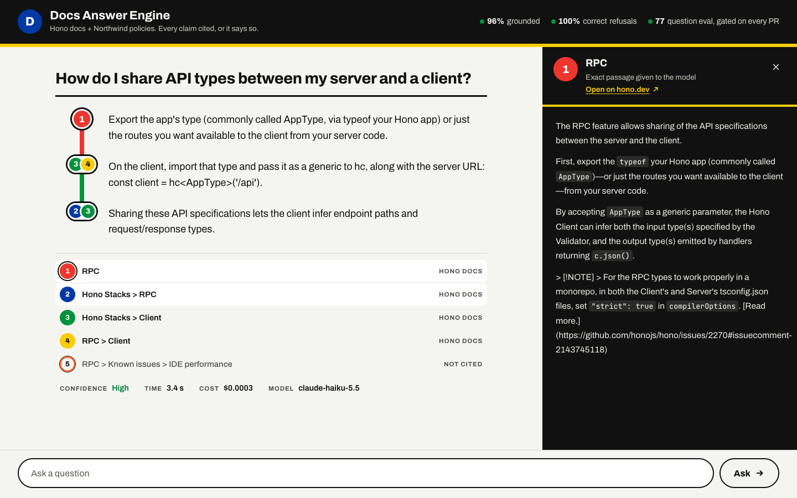
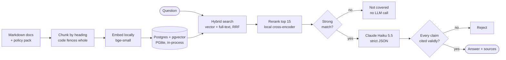
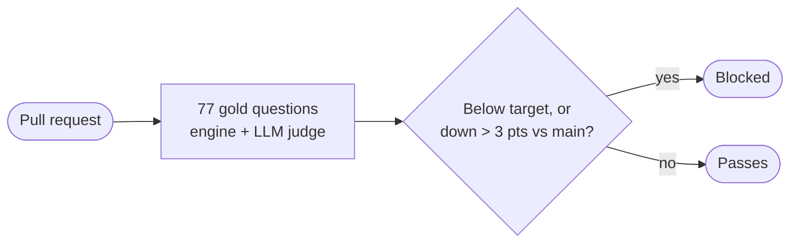
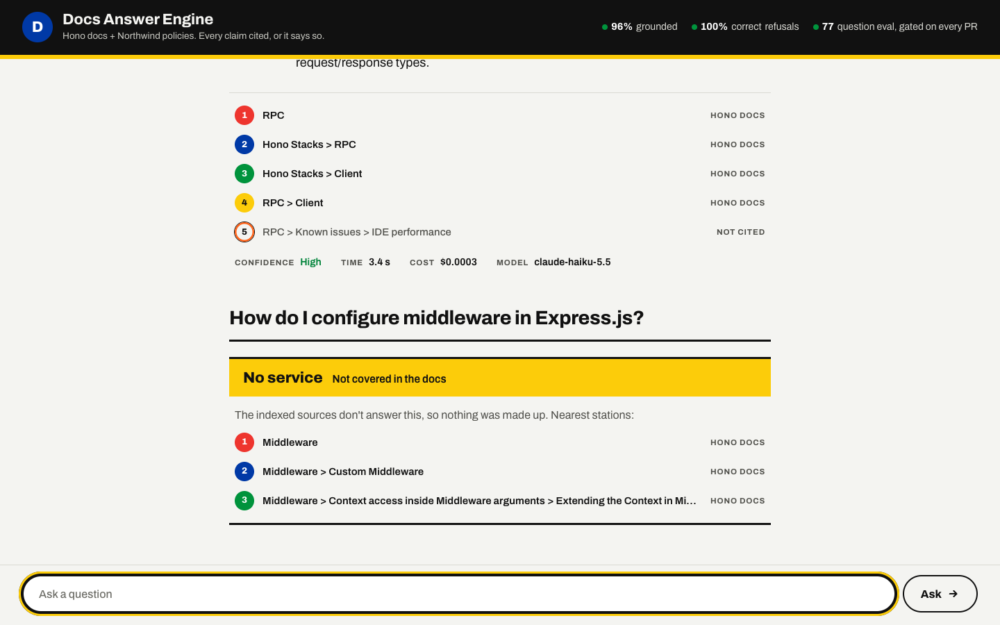
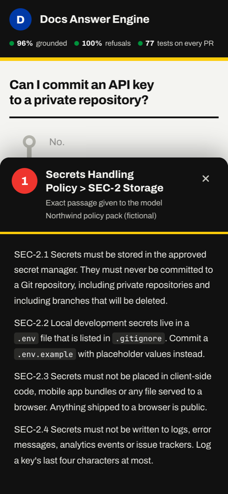

# Developer Knowledge & Compliance Engine

Ask a question about a codebase's docs or the team's engineering policies and get an answer where **every claim cites the passage it came from**. When the docs don't cover a question, it says so and doesn't guess. A CI gate **blocks any pull request that lowers answer quality**.



| | |
| --- | --- |
| **Groundedness** (claims backed by the cited source) | 96% |
| **Correct refusals** (out-of-scope questions declined) | 100% |
| **False refusals** (answerable questions declined) | 2% |
| **Eval set** | 77 hand-written questions, re-run on every PR that touches code, prompts or data |
| **Cost** | $0.0004 per answer, $0.03 for the whole eval run (Claude Haiku 5.5) |

**Read next:** [Case study](docs/CASE_STUDY.md) covers decisions, trade-offs and what went wrong · [Eval gate proof](#eval-gate-ci) shows a bad prompt change going red in CI.

## Why it exists

Teams put AI assistants on their internal docs, and the assistants answer confidently even when they're wrong. They make up an option, give a timeout default from an older version, or tell someone a policy allows what it forbids. Nobody can check the answer quickly, and nobody notices when a prompt tweak makes things worse.

This engine is built around three rules:

1. **Show the source.** Every claim carries a `[n]` that opens the exact passage the model was given.
2. **Refuse rather than guess.** Weak retrieval or an off-topic question gets "Not covered in the docs", along with the nearest pages.
3. **Measure every change.** A gold set of 77 questions runs in CI, and a drop of more than 3 points fails the build.

## Architecture



Ingest runs once at build time (left). Everything from **Question** onward runs per request. Only the Haiku step costs money.



**Stack:** TypeScript on Node 22 · Postgres + pgvector (PGlite) · local embeddings and reranker via transformers.js · Claude Haiku 5.5 through OpenRouter · Zod for every boundary · React 19 + Vite · GitHub Actions · Vitest.

## The interface

Each answer is drawn as a transit route:

- Every sentence is a stop.
- Every source has its own line colour.
- A sentence backed by two sources becomes a transfer station.
- Clicking any bullet opens the exact passage the model read, with a link to the original page.

| Refusal | Phone |
| --- | --- |
|  |  |

More screens:

- Dark mode: [docs/img/dark.png](docs/img/dark.png).
- The header reads its scores live from `evals/baseline.json`, so it can't drift from what CI measured.

## Corpus

- `corpus/hono/`: a snapshot of the [Hono](https://hono.dev) docs (MIT, see `corpus/hono/SOURCE.txt`).
- `corpus/policies/`: a short synthetic engineering policy pack (secrets, code review, data retention) for the compliance angle. Fictional company, not legal advice.

## How it works

1. **Chunk** each Markdown file by heading (H1 to H3), keeping the heading path. Long sections split into ~700-token windows with 15% overlap; code fences are never cut.
2. **Embed** locally with `bge-small-en-v1.5` (no API key, same result in CI).
3. **Store** in Postgres + pgvector, run in-process with PGlite, so there is no server to set up.
4. **Retrieve** with vector search plus Postgres full-text search, merged by reciprocal rank fusion; the top 15 are **reranked** by a local cross-encoder (`ms-marco-MiniLM-L-6-v2`) that reads question and passage together, and the top 5 are kept.
5. **Refuse early** if the best chunk is a weak match (cosine similarity < 0.6): no LLM call, answer "Not covered in the docs."
6. **Answer** with Claude Haiku 5.5 via OpenRouter. The prompt numbers the sources; the model must return JSON matching a Zod schema (`answer`, `citations`, `confidence`, `refused`) with a `[n]` after every claim. Text inside sources is treated as data, not instructions.
7. **Validate**: an answer that cites a source it wasn't given, or answers without citing, is rejected.

## Run it

```sh
npm install
npm run ingest                      # build the index (~25s, downloads the local models once)
npm run query -- "how do I enable CORS?"   # retrieval only
npm run ask -- "how do I enable CORS?"     # cited answer (needs OPENROUTER_API_KEY in .env)
npm run eval:retrieval              # hit rate @5 on the hand-picked questions
npm run eval:answers                # full gold set, LLM judge, writes evals/baseline.json (~$0.05)
npm test                            # unit tests

# chat UI: two terminals
npm run serve                       # API on http://localhost:8787
npm run web                         # UI on http://localhost:5173
```

## Answer quality

77 hand-written questions in `evals/gold.json`:

- 59 answerable, from the Hono docs and the policies.
- 10 out of scope.
- 8 adversarial: false premises and prompt injection.

Groundedness and correctness are scored by Claude Haiku 5.5 acting as judge. Retrieval and the prompt are the same in every column; only the model and the reranker change.

| Metric | Haiku 5.5 + rerank (current) | Haiku 5.5, no rerank | Sonnet 5.5, no rerank | Target |
| --- | --- | --- | --- | --- |
| Schema-valid answers | 100% | 100% | 100% | ≥ 97% |
| Groundedness (claims backed by cited source) | 96% | 96% | 97% | ≥ 90% |
| Correctness (judge) | 95% | 96% | 95% | ≥ 85% |
| Key facts present | 92% | 87% | 92% | ≥ 85% |
| Retrieval hit @5 | 98% | 97% | 95% | ≥ 85% |
| Correct refusal (out-of-scope) | 100% | 100% | 100% | ≥ 90% |
| False refusal (answerable but refused) | 2% | 3% | 3% | ≤ 10% |
| p95 latency | 3.7 s | 3.9 s | 4.5 s | < 5 s |
| Cost, whole run (77 questions + judge) | **$0.03** | $0.04 | $0.53 | report |

Haiku matches Sonnet on groundedness and correctness at about 1/14 of the cost, so it is the default. The `ANSWER_MODEL` setting switches it.

- Haiku cites policy clause ids less often than Sonnet, which explains most of the gap in key facts.
- Reranking fixed the two retrieval misses (timeout middleware, and the test-fixtures policy clause) and lifted key facts from 87% to 92%.
- Still weak: for the Proxy helper, retrieval finds the intro but not the usage example.

## Running it in public

- **Logging:** one JSON line per question on stdout. It records the question, retrieved chunk ids, model, prompt version, whether it refused, latency, tokens, cost and status.
- **Rate limits** (`src/limit.ts`):
  - 10 questions a minute and 100 a day per IP.
  - 2,000 a day in total, to protect the API credit.
  - Kept in memory, so they only work with a single instance.
- **Invite-only:** the API refuses every question without an access code. Set `ACCESS_CODES` to `name:code` pairs, comma-separated, one per person (`openssl rand -hex 8` makes a code). Each guest gets 10 answered questions, counted in `.data/usage.json` so a restart doesn't reset them; add a third field to change it (`sam:code:25`, or `vadim:code:unlimited` for the owner). Ten wrong codes from one address lock it out for the day. Share a code, or a link like `https://<site>/?code=<code>` that unlocks in one click. To revoke someone, delete their pair and restart. Logs record the name, never the code.
- **Share from this machine:** `npm run share` builds the UI, serves it and the API from one port, and prints a temporary public `trycloudflare.com` link (needs `brew install cloudflared`). Ctrl+C stops sharing.
- **CORS:** when the UI and API are on different domains, set `ALLOWED_ORIGIN` to the UI's origin. The UI reads `VITE_API_URL` at build time.
- **Deploy:**
  - `vercel.json` builds the UI.
  - The API ships with `render.yaml` or the `Dockerfile`.
  - `npm run ingest` runs at build time and bakes in the index and both local models.
  - The API needs about 1 GB of RAM (PGlite takes ~480 MB idle, plus two models; ~900 MB measured after a few questions). That rules out 512 MB free tiers, but a free Hugging Face Docker Space fits.

## Eval gate (CI)

Every pull request that touches code, prompts, corpus or the gold set runs the full gold set in GitHub Actions (`.github/workflows/evals.yml`, about $0.05 a run) and posts a score table as a PR comment. The job goes red if any metric misses its target or drops more than 3 points from the baseline committed on `main`.

| Gated metric | Target |
| --- | --- |
| Schema-valid answers | ≥ 97% |
| Groundedness | ≥ 90% |
| Correctness (judge) | ≥ 85% |
| Key facts present | ≥ 85% |
| Retrieval hit @5 | ≥ 85% |
| Correct refusal | ≥ 90% |
| False refusal | ≤ 10% |

Latency and cost are reported, not gated. To move the baseline on purpose, run `npm run eval:answers` and commit `evals/baseline.json` in the PR.

**Proof:**

- [PR #1](https://github.com/kravitzvadim-cl/developer-knowledge-engine-showcase/pull/1) weakens the system prompt by dropping "only use the provided sources" and the refusal rule.
- The gate [goes red](https://github.com/kravitzvadim-cl/developer-knowledge-engine-showcase/actions/runs/38235125518): correct refusal falls from 100% to 58%, and groundedness drops 5 points.
- Reverting the change [turns it green](https://github.com/kravitzvadim-cl/developer-knowledge-engine-showcase/actions/runs/38235982317).

A separate free job (`ci.yml`) runs type-check, unit tests and the retrieval check on every push.

## Project log

Built in seven steps over a week. The commit history matches these steps.

| Step | What shipped |
| --- | --- |
| 1–2 | Ingestion, chunking, local embeddings, hybrid retrieval, retrieval check |
| 3 | Cited answers, schema validation, refusal, 77-question gold set, first baseline |
| 4 | CI eval gate with PR comments; red/green proof; switch to Haiku after measuring it |
| 5 | Chat UI with clickable citations and a source panel |
| 6 | Cross-encoder rerank, Transit Line Map redesign, logging, rate limits, deploy config |
| 7 | This README, architecture diagram, case study |
