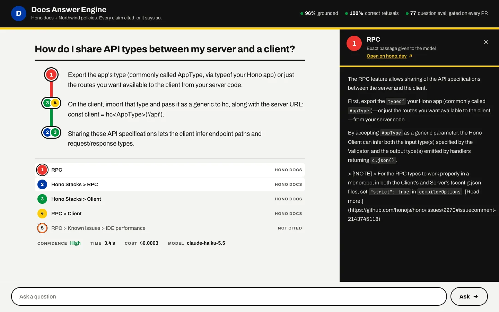

# Developer Knowledge & Compliance Engine

A prototype documentation assistant built around claim-level citations, explicit refusals, and repeatable answer-quality evaluation.

[Portfolio case study](https://vadim-kravets.vercel.app/work/dev-knowledge-engine/) · [Vadim Kravets](https://vadim-kravets.vercel.app/)



## My role

Product direction, problem framing, scope, design decisions, and review. AI coding agents wrote implementation code and tests under my direction. This is an independent portfolio project.

## What to explore

- Hybrid retrieval and local reranking
- Source passages attached to generated claims
- A documented evaluation set and quality-gate implementation

## Try it locally

```sh
npm ci
npm test
npm run typecheck
npm run build
```

Inspect the source and [GUIDE.md](GUIDE.md) for the architecture. Recorded evaluation scores describe the original project's own corpus and test set; they are not a new independent benchmark. Live AI requests are disabled by default, including when an API key is inherited from your shell. Corpus ingestion downloads local-model weights and makes no paid model calls.

## About this public copy

This is a curated showcase snapshot with fresh Git history. It contains no production credentials, private project-session records, owner databases, or connection to the private working repository. Changes to this copy do not deploy or modify the working app. It has no inherited deployment integration, repository secrets, or paid Actions workflow.

The code can be reviewed and run locally. Forks and proposed changes do not grant write access to the original app. Public source is not a guarantee that software has no bugs.

[Usage and architecture reference](GUIDE.md) · [Publication checks](PUBLICATION.md)

## License and third-party material

Source is shared for portfolio review; no additional open-source license is granted for my original code. Bundled libraries, fonts, and documentation retain their respective licenses and notices.
